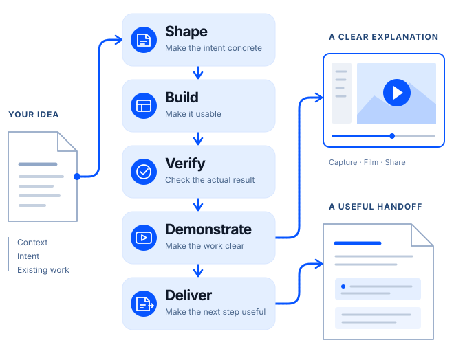

# Aaron Skills

[English](README.md) | [简体中文](README.zh-CN.md) | [Website](https://skills.aaronguo.com/)

**From intent to work people can use.**

Reusable methods and tools for working with AI agents. Shape the idea, build it
with care, check the result, and make it clear to the next person. Use the
capabilities your task needs; they are not a compulsory sequence.

<p align="center">
  <a href="https://skills.aaronguo.com/#skills">
    
  </a>
</p>

## Choose the help you need

| Capability | The essence | Availability |
| --- | --- | --- |
| [Shape](https://skills.aaronguo.com/#skill-shape) | Make the intent concrete: a proposal someone can inspect, correct and act on. | Included · `feature-blueprint` |
| [Build](https://skills.aaronguo.com/#skill-build) | Close the gap to usable work, using the project's existing methods and design. | Included · `build-delivery` |
| [Verify](https://skills.aaronguo.com/#skill-verify) | Check the actual promise. Exercise the result, repair problems and check again. | Included · `verify-delivery` |
| [Demonstrate](https://skills.aaronguo.com/#skill-demonstrate) | Record the real flow and explain the checked result for its audience. | Demo released · Capture / Film / Share |
| [Deliver](https://skills.aaronguo.com/#skill-deliver) | Make the next step clear so someone can review, use or continue the work. | Included · `deliver-work`; optional Share packaging |

[Explore one fictional missing-receipt case](https://skills.aaronguo.com/#skills):
a focused proposal, an interactive interface sketch, acceptance checks, a
storyboard and a copyable handoff. These illustrate the methods; they are not
release or benchmark evidence.

**v1.0.0 installs all seven skills** through the standard setup below: Shape, Build,
Verify, Capture, Film, Deliver and Share. Shape / Build / Verify / Deliver are
portable instructions with no service dependency; Capture / Film / Share use the
existing local Demo toolchain. Keep the [existing invocation IDs](docs/skill-names.md).
See the [full workflow](docs/task-delivery-workflow.md) and [Shape guide](docs/feature-blueprint.md).

For example, ask `$verify-delivery` to check an existing deliverable, fix scoped
issues and recheck it; ask `$deliver-work` to prepare its actual recipient handoff.
Neither request authorizes sending or publication.

## Available now: Demo

Turn a working web feature into a guided video, screenshots and a copyable update.
The released bundle connects three skills through a shared local toolchain:

| Skill | What it does |
| --- | --- |
| [Capture](skills/demo-capture/SKILL.md) | Record real actions, check the result and save the evidence. |
| [Film](skills/walkthrough-video/SKILL.md) | Make a guided video or branded cover. Refine the explanation without repeating business actions. |
| [Share](skills/paste-ready-update/SKILL.md) | Prepare a reviewable HTML update with copyable text, screenshots and optional video. |

[Watch eight narrated examples](https://skills.aaronguo.com/#examples). Each case
reuses one checked recording for different audiences and purposes.

| Fictional product demo | Public content walkthrough |
| --- | --- |
| [](https://skills.aaronguo.com/#example-ledgerlane) | [](https://skills.aaronguo.com/#example-blog) |
| Two invoices. One checked decision. | A reading journey through Builder Notes. |

Explore [32 cover styles](https://skills.aaronguo.com/covers) and
[six matched video treatments plus two unframed choices](https://skills.aaronguo.com/layouts).
The examples are curated showcases, separate from benchmarks.

## Install Aaron Skills

Runtime targets: **macOS arm64, Ubuntu 24.04 x64 and native Windows 11 x64**.
See [compatibility](docs/compatibility.md) for measured platform and host coverage.
Requirements: Git, Python 3.11+, Node 22+ with npm, and FFmpeg/ffprobe.
The installer adds pinned browser, video and Python dependencies. The public
example needs no customer account or paid API.

```sh
git clone https://github.com/aaronguostudio/aaron-skills.git
cd aaron-skills
# macOS / Ubuntu; use claude, cursor or both instead of codex if needed:
bash scripts/setup.sh --agent codex --smoke
```

On native Windows, clone the same repository, then run in ordinary PowerShell:

```powershell
powershell.exe -NoProfile -ExecutionPolicy Bypass -File scripts/setup.ps1 --agent codex --smoke
```

Windows needs no WSL or administrator token; execution-policy bypass applies only
to that process. Prerequisites must already be installed; Ubuntu also needs
Chromium system libraries. See [installation and recovery](docs/installation.md)
for preparation, agent registration, isolated coexistence and uninstall.

## Make your first demo

Ask your local agent:

> Use Capture to demonstrate this feature in my local app. Show the starting
> state, important actions and checked result. Produce a short silent walkthrough
> and an update page for me to review. Reuse the recording for presentation
> revisions. Do not send or publish anything.

The agent can inspect the app and author a small adapter describing its URL,
steps and checks. Review write operations and production gates before recording.
Sign in yourself in the visible browser; the skill does not type credentials. See [first demo](docs/first-demo.md) and
[project adapters](docs/project-adapters.md).

```sh
aaron-demo capture --project /path/to/app --env local --walk tour
aaron-demo render /path/to/passed-run --stills
aaron-demo inspect /path/to/passed-run
```

Choose the script, voice and visual treatment independently. Film can draft from
your brief and captured evidence. Rendering is silent by default; import audio,
use your cloud/company voice, or optionally install free local narration.
`aaron-demo voice setup` guides setup. See [narration](docs/narration.md),
[cover selection](docs/cover-library.md), [video layouts](docs/video-layouts.md)
and [presentation revisions](docs/presentation-revisions.md).

Check your version with `aaron-demo version`. Clean managed installations check
in the background and automatically install verified compatible patches; larger
changes need your choice. Use `aaron-demo update`, `aaron-demo rollback`, or
`aaron-demo update policy notify|off`. Modified-source installations stay manual.
See [versions and updates](docs/updates.md).

## Privacy and scope

Recordings, sessions and generated pages stay outside Git. Outputs can contain
real screens; inspect them before sharing. Optional [solid-region masking](docs/data-masking.md)
covers selected areas in exports; it does not automatically detect personal data,
blur or track regions. Raw recordings remain unredacted local working material.
Adapters are trusted executable JavaScript; the browser guard is not a sandbox
for malicious adapters. See [data and network behavior](docs/data-and-network-behavior.md).

Host registration and runtime compatibility do not certify model invocation.
Read [compatibility](docs/compatibility.md) for the measured scope.

## Develop and extend

Start with [CONTRIBUTING.md](CONTRIBUTING.md), [local development](docs/local-development.md),
[verification](docs/verification.md) and [evaluation](docs/evaluation.md).
Keep deterministic tests, model behavior and visual acceptance distinct.

## Author and license

Built by **[Aaron Guo](https://aaronguo.com)**. Both READMEs cover the overview and
getting started; detailed technical references remain in English. Commands,
paths and skill IDs are the same in both languages.

Original code is [MIT](LICENSE). Dependencies retain their own terms; Remotion's
free-use eligibility and Company License conditions apply. See
[third-party notices](THIRD_PARTY_NOTICES.md) and [SECURITY.md](SECURITY.md).
