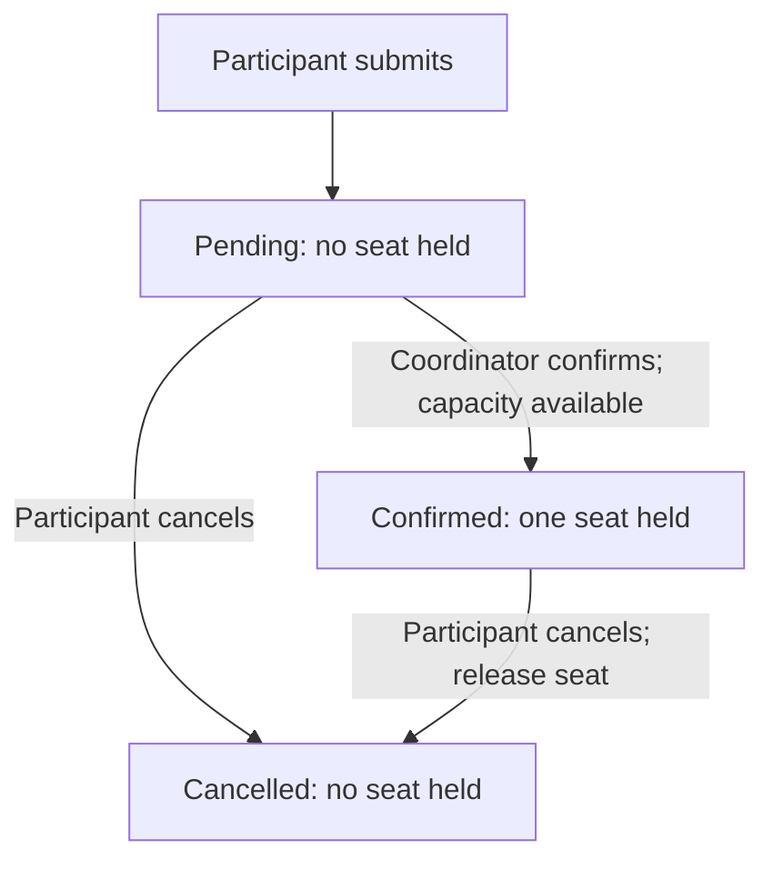
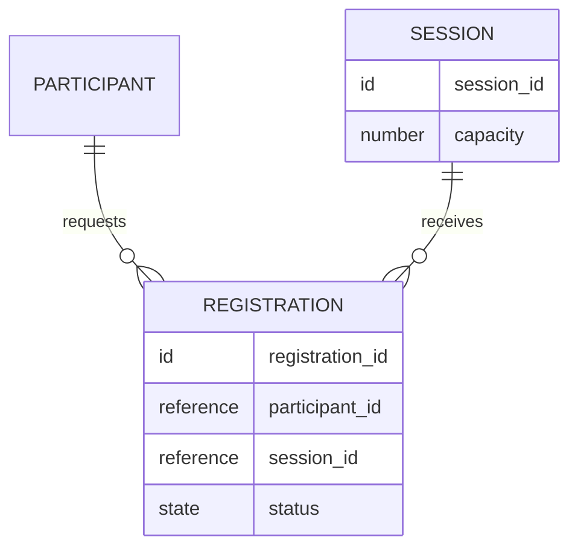

# Choosing the delivery

Read when the question is how to present the understanding so someone can act.
The examples are entirely fictional and authored. Scripted owner answers are
illustration, not real customer approval or independent behavioral evidence.

## Choose for the receiver's next action

Start with the next receiver, the action or decision they need to make, and the
product result it serves. Then create the expression that makes that action
possible. Reuse an existing ticket, conversation, design or model when it fits.

- A customer needs to recognize the interpretation and supply missing context:
  prepare the actual reply, including the material question and why it matters.
- A decision maker needs to choose: expose the proposed scope or alternatives,
  a recommendation and its consequence. Preserve what is already settled.
- Someone needs to assess the experience: show the relevant screen, interaction
  and resulting state in context. A design may discover a missing rule.
- Actors, conditions or state transitions are unclear: draw the flow and its
  consequential branch, including who can act and what happens on failure.
- Identity, ownership, persistence or relationships are unclear: model the few
  concepts that explain those rules. A conceptual model need not choose a database.
- A person or agent needs to execute: carry the purpose, scope, behavior, relevant
  artifacts, success examples and unresolved choices into a usable handoff.

These are judgment aids, not modes to select formally or documents to produce in
order. One reply can be the complete delivery. A sketch may come before the right
question is known. Add an expression when it exposes or resolves a consequential
gap; do not make all of them merely because they are available.

Prepare communication for its actual audience and channel. A request to shape a
need does not authorize contacting anyone. If the user explicitly authorizes
delivery, use the requested destination within that scope and verify the result.
Keep a prepared draft, a confirmed decision and a delivered message distinguishable.
No particular connector, document service or sharing provider is required.

## Let the explanation lead to a decision

State the requested change directly in one or two sentences. A long meeting can
be grouped into distinct requests. Then explain the situation the receiver
recognizes and your recommended first move with its reason. Develop that understanding through
a concrete example whose important details are supported. Keep illustrative
values and proposed behavior visible as such. Storytelling here means coherent
reasoning and a useful progression; it does not require drama or a fabricated
personal anecdote. Use titles such as "Track payment status" or "Who updates the
record" rather than slogans that make the reader infer the subject. Omit
decorative blue eyebrows, all-caps labels, edition breadcrumbs and repeated
general disclaimers. Retain useful dates and consequential uncertainty.

For the default proposal page, use the short stable labels Requirements,
Operating model, Prototype, Data model and Next steps. Put the project's specific
meaning in the content and screen names. Do not make the reader relearn the
navigation through synonyms or editorial titles. A different user-requested format
or medium can use its own structure.

Make the business value concrete: what could someone judge or do differently
with the proposed result? Follow that through the operating loop, including who
maintains it, when it is updated, where someone reviews it and what follows.
Distinguish a useful recommendation about that loop from an agreed practice.

Use the visual as part of the explanation. Give connected screens or a model a
dedicated, inspectable space when that helps the task. Follow an example through
its states, then use selective annotations to expose the choice or consequence.
A list of field descriptions in boxes may still leave relationships unclear.
Put a full field inventory or implementation discussion in supporting material
when the receiver first needs to understand the experience.

Choose a reading surface that preserves continuity. In a one-page proposal, show
the decisions and next action directly; keep necessary technical or source detail
in local expandable sections when it would otherwise bury the design. Do not
require the reader to leave the proposal and find their way back for that detail.
Use external links for original sources or independently useful artifacts when
appropriate. A one-page design is an option, not a universal required format.

For substantial web proposals, use the
[proposal-page template](../assets/review-page.html) as the default reading
surface. Replace its fictional workshop content with the current request, keeping
the five top-level headings and their matching sidebar labels unchanged. Keep the left navigation sticky on desktop and highlight
the section currently being read, including after manual scrolling, anchor
navigation and layout changes. Make the current location available to assistive
technology. On narrow screens retain navigation without squeezing the content;
the template uses a compact sticky row. Preserve normal keyboard navigation and
reduced-motion preferences. Change top-level labels or count only when the user
explicitly asks for a different format.

Keep the sidebar and visible section headings identical, including casing:
Requirements, Operating model, Prototype, Data model and Next steps. Use Operating model to explain
who participates or is affected, what triggers their work, how states or steps
progress and what decisions or actions follow. Include adoption or organizational
change planning when the request needs it, rather than assuming those are covered
by describing an operational workflow.

For several application pages, give the receiver a canvas overview of the named
frames and a way to focus, pan and zoom into a readable screen. Connect the useful
interactions and keep form inputs separate from viewport gestures. Use the host's
existing canvas tools or a suitable implementation; the skill does not require a
particular library. Label the example data once and keep unresolved choices in
short adjacent notes or local supporting detail. Do not fill the screen with the
evaluation rationale, implementation caveats or repeated instructions. Inspect
controls at a readable scale: dropdown text and arrows need deliberate padding
inside their borders, and focus, click targets and empty states must remain usable.

Give each idea one home and one primary expression:

| Section | Main surface | Supporting detail |
| --- | --- | --- |
| Requirements | One plain list: addition + use. No separate value/recommendation callouts repeating the opening. | Source wording needed to interpret a requirement. |
| Operating model | One list, table **or** flow covering roles, timing and follow-through. | Exceptions and unagreed policy rationale. |
| Prototype | Working canvas and one demo marker; at most a short necessary instruction. | Assumptions and longer how-to notes. |
| Data model | Relationships and existing/extend/new/calculated labels **in the diagram**. | Actual-schema checks and unresolved links. |
| Next steps | Can start now / Need to confirm / Outside this first version. Short actions and decision owner/dependency. | Options, recommendations and tradeoffs for those same decisions. |

The canvas controller and fictional application are separate scripts; reuse or
adapt the former, replace the latter. Keep the connected journey usable. Do not
add an introductory essay above the diagram or instructions above every screen.
A material unresolved choice can have a short local marker without copying its
full explanation into several sections.

### Prototype annotation ownership

Keep shared assumptions outside the application frames, in one collapsed
Prototype details disclosure beside the canvas. This is the home for demo data,
period/currency conventions, access assumptions and whether saves persist. A
short basis label at the result is useful; repeating the same period explanation
or permission disclaimer on the list, detail and entry screens is not.

Keep a local Proposed marker on an unresolved field or action. Its full rationale
belongs in the shared detail or the relevant next-step decision, not both. A normal
save should reveal the updated record or a brief Saved message; do not append a
paragraph explaining persistence, latest-record rules or what changed. Preserve
inline errors that explain a failed action and any specific confirmation needed
to make a consequential action understandable. Concision must not hide a real
validation error, decision status or misleading comparison basis.

Inspect every frame before delivery. Remove repeated period, access, default and
save notices, and repeated instructions around controls. Let values, field labels,
status and connected interactions explain the normal journey. The template shows
one shared disclosure and state changes without a success essay.

Before handing over, inspect only the expanded main surface. Remove repeated
claims, including repeats expressed as a table, then a flow, then action bullets.
Move detailed rationale under its one relevant disclosure. Keep important
requirements; compress repetition rather than deleting meaning to meet a word
quota. Check exact section labels and consequential source wording. This is an
internal editing pass, not a new visible checklist or verification section.

Build the primary reading surface before writing an optional detailed appendix.
Prefer the available renderer/browser and existing reusable controls. When a tool
cannot render or inspect the result, record that limit and complete the useful
artifact rather than developing a custom renderer. A completed handoff with an
honest verification limit is more useful than an unfinished tool-building detour.

This default applies to proposal pages. A short reply, an existing native design,
a slide deck or a document should keep the medium and conventions the user needs.

For the fictional workshop below, a useful opening is: "People are planning to
attend as soon as they submit, although staff have not confirmed their seats.
I recommend showing a pending request and a confirmed seat as different states,
so the participant knows when they can rely on a place." The three result views
can then show the difference directly. Capacity handling explains why the states
matter; extra platform detail can wait until the implementation handoff.

Review the explanation by what a receiver can understand and decide after
reading it. Identify the actual passage or visual that helps or obstructs them.
Use enough detail to preserve the meaning within the proposal's compact structure;
a word quota does not establish clarity.
A polished explanation that still leaves them assembling the central meaning
needs revision. Check the actual viewing size, section navigation and any local
disclosures when the medium supports them. A mockup should show the relevant
experience, not substitute field descriptions for the screen or shrink the whole
journey until it cannot be read. Preserve unfavorable human feedback even when an earlier model
review passed; a rule change remains unproven until the new work is inspected.

## One fictional need, several useful expressions

**Initial request:** "People submit our workshop form and assume they have a
seat. Staff then have to explain that they are still waiting. Make it clearer."

**Supplied context:** The existing form records a registration request. It does
not reserve a seat. A coordinator currently decides who is confirmed. Participants
already have records in the project. The future waitlist policy is undecided.

### Customer reply: expose the interpretation and ask what changes the design

> My understanding is that people are treating a received request as a confirmed
> seat. I suggest making those two states visible, so people know whether they
> can plan to attend. Before I sketch that, should confirmation continue to come
> from the coordinator, or should submitting the form itself reserve a seat?
> That choice changes both the message and the capacity behavior.

This is a prepared draft, not a sent message. The question is about a product
choice that changes what the interface may promise. The agent need not ask the
customer how the existing form stores data when project evidence can answer it.

**Scripted fictional owner reply:** "Keep coordinator confirmation. Only confirmed
registrations use capacity. Participants can cancel a pending or confirmed
registration; cancelling a confirmed registration releases its seat. Keep the
waitlist outside this pilot. Do not add email notifications."

### Scope confirmation: make the proposed delivery inspectable

> For this pilot, submitting creates a pending request and clearly says that a
> seat is not yet confirmed. The coordinator can confirm a request when capacity
> is available. Participants can cancel; only confirmed registrations use seats.
> The design will show pending, confirmed and cancelled states. Waitlist handling
> and email notifications are outside this pilot. We will check whether people
> can tell when they have a seat without asking staff to interpret the status.

This carries the owner's answer forward. It does not require another approval
round just to repeat settled decisions. Observing the intended outcome with real
participants would need its own test; this example does not prove it.

### Design: show what the participant will actually understand

Use the current form's conventions. A focused sketch can show these three result
cards rather than redesigning the whole product:

**After submission — Request received**

> Your seat is awaiting coordinator confirmation. You do not have a confirmed
> seat yet. [View request] [Cancel request]

**After coordinator confirmation — Seat confirmed**

> Your seat for the selected workshop is confirmed. [View registration] [Cancel]

**After cancellation — Registration cancelled**

> This registration no longer holds a seat. [Back to workshops]

These are proposed screen contents, not an implemented UI. Match the actual
project's terminology and available actions. Do not add a waitlist promise or
email promise. If the design shows capacity as unavailable, a pending request
stays pending; no automatic queue-order decision is implied.

### Flow: expose the state and ownership behind the wording

The failed confirmation branch matters too: when no seat is available, confirmation
does not succeed and the registration remains pending. Do not infer a waitlist
ordering rule from this flow. The final implementation must enforce capacity;
an interface-only disabled button would not establish that behavior.

### Conceptual model: keep the same meaning across the records

Reuse the existing participant identity; this example does not introduce a new
identity store or matching rule. A registration connects a participant to a
session. Status is pending, confirmed or cancelled. Capacity usage is the count
of confirmed registrations for the session. Do not silently treat all submitted
records as seat reservations or invent a duplicate-registration policy. Database
schema, concurrency mechanism and identity integration belong to implementation
planning against the actual project.

### Execution handoff: preserve the product outcome through the technical work

> Help participants distinguish a received request from a confirmed seat. Reuse
> the existing form and participant records. Submission creates a pending
> registration and shows that no seat is held. A coordinator may confirm when
> capacity is available. Only confirmed registrations consume capacity.
> Participants can cancel pending or confirmed registrations; cancellation of a
> confirmed registration releases its seat. Keep the result cards, state flow
> and registration status consistent. No waitlist or email work in this pilot.
>
> Verify that submission never presents a seat as confirmed; coordinator
> confirmation changes both status and capacity usage; a capacity failure leaves
> the request pending; cancellation releases only a confirmed seat; and competing
> confirmations cannot exceed the session capacity. Check the existing handling
> of duplicate requests and failed writes before choosing the implementation.
> Use the project's chosen engineering workflow for the technical plan.

This is an execution brief, not authorization to deploy or send messages.
The receiver can trace the technical constraints back to the participant's need.

## Check the delivery rather than the amount produced

For the expressions actually needed, check whether the next receiver can use
them: Can the customer recognize the interpretation and answer the question?
Can the decision maker see what is settled and what remains theirs to choose?
Does the design make the product behavior inspectable? Do flow and model preserve
the same actors, states and rules? Can the builder explain the intended result
and identify success without inventing product decisions?

Feedback can reveal a wrong interpretation, a missing rule or an unsuitable form.
Revise the affected expressions together. A polished model that contradicts the
customer message has not completed the handoff. A simple clear reply may already
have done enough. Evaluation should inspect the usefulness and consistency of the
delivery, including unnecessary work, rather than require higher reasoning scores
than a capable base model. Existing comparisons remain evidence about their frozen
candidates and tasks; they do not certify a later revision.
